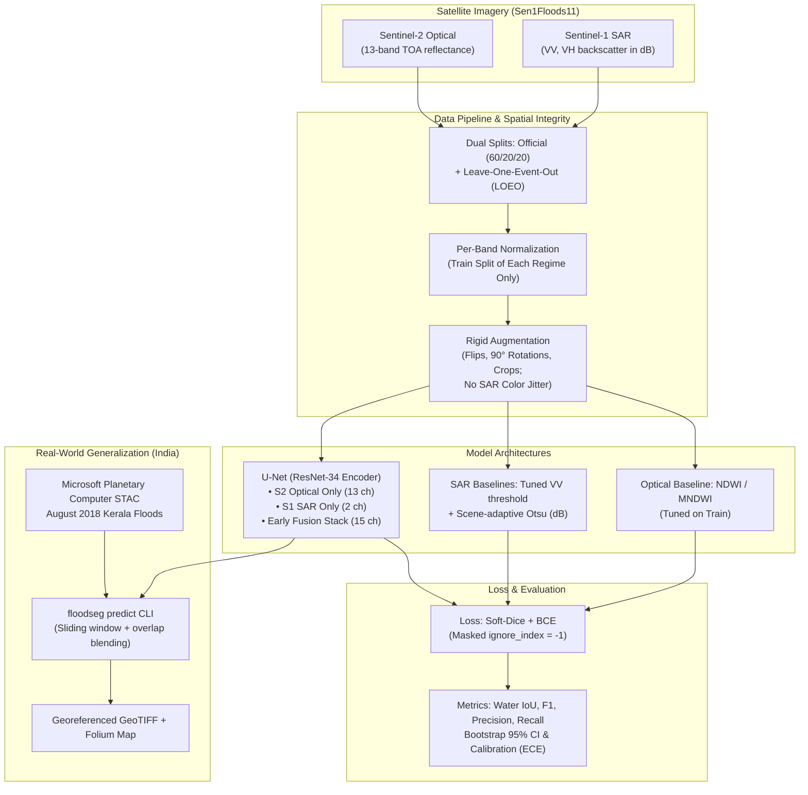

# FloodSeg: Satellite Flood-Water Segmentation (Sentinel-1 SAR vs Sentinel-2 Optical)

[](https://creativecommons.org/licenses/by/4.0/)
[](pyproject.toml)
[](https://www.python.org/downloads/)
[](https://pytorch.org/)

> **Headline Research Question:**
> *"How much does Synthetic Aperture Radar (SAR), which penetrates clouds and storm cover, improve flood mapping over optical imagery, and where does each modality fail?"*

---

## 1. System Architecture



---

## 2. Benchmark Results (Sen1Floods11)

> All numbers are produced by the scripts in `scripts/` and stored in `outputs/results/`. U-Net rows are mean ± sample std over 3 seeds (42, 1337, 2024) of the Milestone 3 grid.
>
> **Water IoU** is pooled over all valid pixels in the evaluation split (no-data `-1` excluded). Brackets are 95% CIs from a 2,000-sample chip-level bootstrap. **Held-out events** = LOEO regime: India + Bolivia never seen in training, normalization or threshold tuning (thresholds re-tuned on the LOEO train split).

| Model / Baseline | Modality | Input Bands | Official Test IoU (%) | Held-Out Event IoU (%) | Parameters |
| :--- | :--- | :--- | :---: | :---: | :---: |
| **NDWI Threshold** | Optical | Green, NIR | 76.5 [67.8, 83.7] | 69.5 [63.0, 74.8] | 0 |
| **MNDWI Threshold** | Optical | Green, SWIR1 | 77.3 [68.4, 84.0] | 64.2 [55.6, 71.3] | 0 |
| **VV Global Threshold** | SAR | VV (dB) | 45.6 [32.0, 57.3] | 46.1 [34.6, 55.6] | 0 |
| **Otsu (scene-adaptive)** | SAR | VV (dB) | 21.2 [14.7, 28.0] | 24.4 [17.7, 31.4] | 0 |
| **U-Net (ResNet-34)** | Optical (S2) | 13 bands | **82.5 ± 0.3** | **73.7 ± 0.5** | 24.4M |
| **U-Net (ResNet-34)** | SAR (S1) | 2 bands (VV, VH) | 67.3 ± 1.2 | 53.1 ± 2.8 | 24.4M |
| **U-Net (ResNet-34)** | Early Fusion | 15 bands | **82.7 ± 1.2** | 71.8 ± 1.9 | 24.4M |

Full baseline table (F1, precision, recall, chip-mean IoU): [`outputs/results/baselines_table.md`](outputs/results/baselines_table.md). U-Net results, paired modality tests and the loss ablation: [`outputs/results/m3_table.md`](outputs/results/m3_table.md).

**Key findings (Milestone 3):**
- **U-Nets beat every non-learned baseline.** On official test, optical is up 5.2 pp over MNDWI and SAR is up 21.7 pp over the tuned VV threshold.
- **SAR generalises worst.** Its gain over the VV-threshold baseline shrinks from +21.7 pp (official test) to +7.0 pp on held-out events, and its seed-to-seed spread on Bolivia is large (58.6 ± 12.4).
- **Optical beats SAR** by 15.2 pp (official) and 20.5 pp (held-out events); paired chip bootstrap, p < 0.001.
- **Early fusion does not beat optical alone.** Official test: +0.2 pp, CI [−1.3, +1.6], p = 0.76. Held-out events: fusion is slightly *worse* (−1.9 pp, CI [−2.8, −1.1]), consistent with the extra SAR channels adding event-specific signal that does not transfer.
- **Caveat:** Sen1Floods11 hand labels were drawn largely on usable optical scenes, so SAR's cloud-penetration advantage is barely exercised here. Testing that is the next milestone's goal (cloud-stratified failure analysis).
- **Loss ablation (seed 42):** Dice-only and BCE+Dice are within 2 pp IoU; BCE+Dice is better calibrated for SAR (ECE 2.1% vs 3.6%). All BCE+Dice models are well calibrated (ECE 1.0–2.5%).

---

## 3. Quickstart & Verification

```bash
# 1. Setup Environment
python -m venv .venv
source .venv/bin/activate  # Or on Windows: .\.venv\Scripts\Activate.ps1
pip install -e ".[dev]"

# 2. Run Data Pipeline & Sanity Tests
make test
python scripts/run_milestone1_pipeline.py   # download all chips, splits, train-only stats
python -m floodseg.cli compute-stats         # (re)compute stats for official + LOEO regimes

# 3. Milestone 2: non-learned baselines
python scripts/run_baselines.py

# 4. Milestone 3: U-Net training (Hydra; any config key can be overridden)
python scripts/train_model.py dataset.modality=s1 dataset.split_type=loeo seed=1337
python scripts/run_m3_grid.py        # full 21-run grid (resumable) + aggregation
python scripts/aggregate_m3.py       # -> outputs/results/m3_table.md
```

---

## 4. Documentation Links
* [DESIGN.md](docs/DESIGN.md): Detailed architectural choices, spatial autocorrelation leakage decisions, and loss formulation.
* [CITATIONS.md](docs/CITATIONS.md): Dataset licenses, sensor citations, and paper references.
