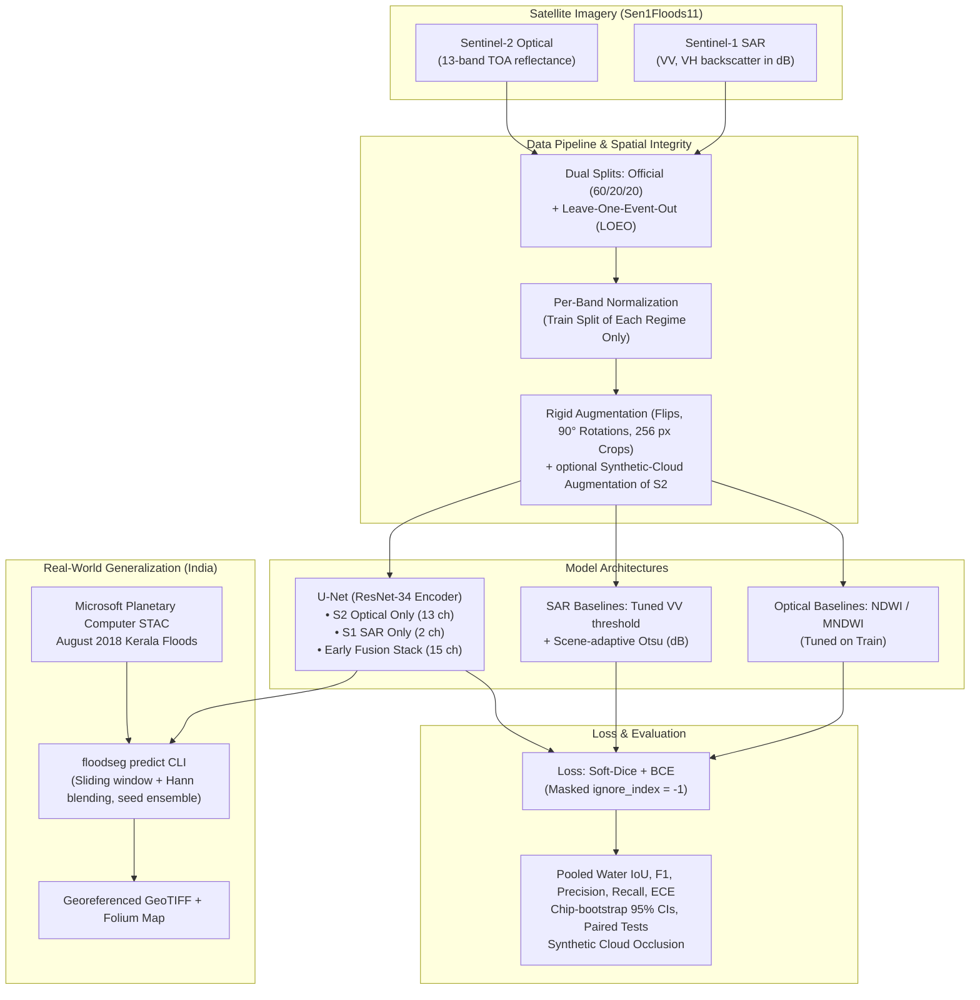
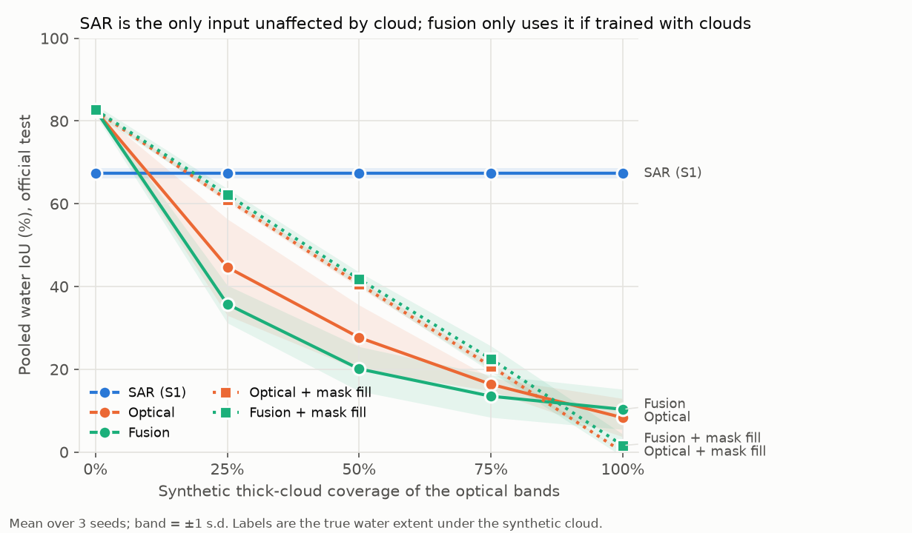
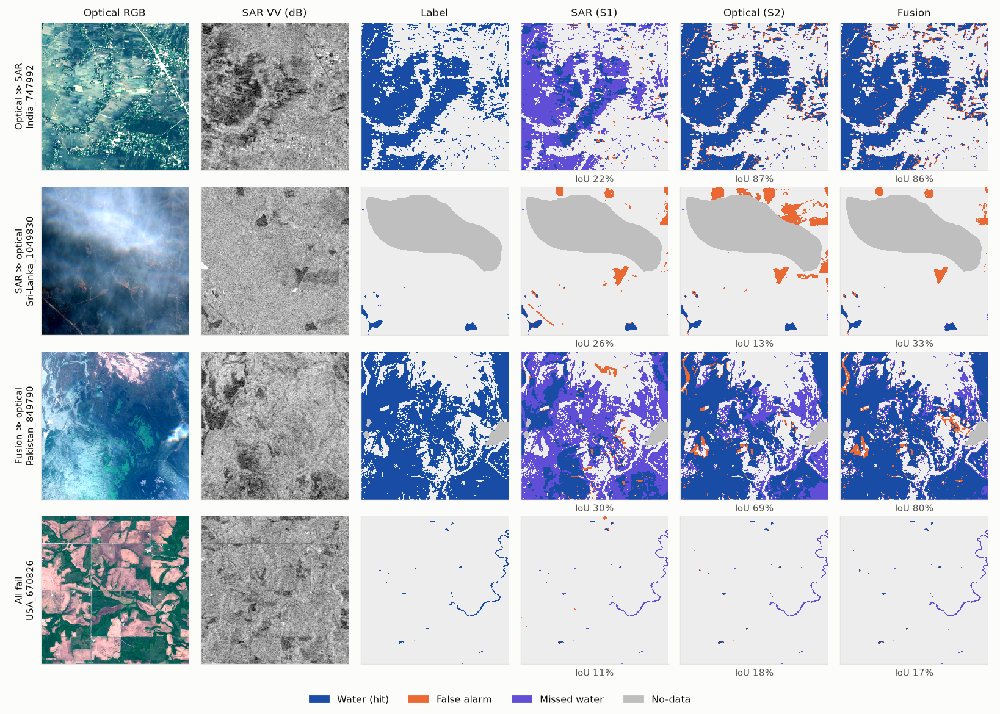
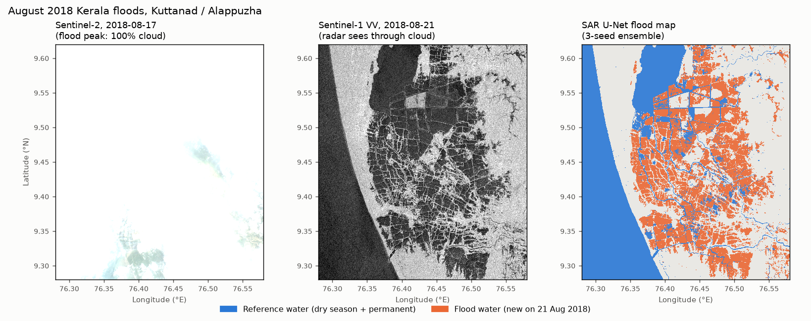

# FloodSeg: Satellite Flood-Water Segmentation (Sentinel-1 SAR vs Sentinel-2 Optical)

[](.github/workflows/ci.yml)
[](https://creativecommons.org/licenses/by/4.0/)
[](LICENSE)
[](https://www.python.org/downloads/)
[](https://pytorch.org/)

> **Headline research question:**
> *How much does Synthetic Aperture Radar (SAR), which penetrates clouds and storm cover, improve flood mapping over optical imagery, and where does each modality fail?*

**Short answer.** On Sen1Floods11's labelled (largely cloud-free) pixels, optical beats SAR by 15–20 IoU points and adding SAR to optical gives no gain. Once clouds cover the optical bands, **SAR is the only input that keeps working** (67% IoU at any cloud cover, vs. 8% for optical under full cover). A standard early-fusion model **does not fall back on its SAR channels** and collapses like optical alone. In the August 2018 Kerala floods, both Sentinel-2 images of the peak (15 and 17 Aug) were 100% clouded. The SAR model mapped **314 km² of new flood water**, and on the clear pixels of an optical image taken one day later it agrees with an optical water index at 80% IoU.

---

## 1. System Architecture



---

## 2. Benchmark Results (Sen1Floods11) — Milestones 2 & 3

> Every number is produced by a script in `scripts/` and stored in `outputs/results/`. **Water IoU** is pooled over all valid pixels of the split (no-data `-1` excluded). Brackets are 95% CIs from a 2,000-sample chip-level bootstrap; U-Net rows are mean ± sample s.d. over 3 seeds (42, 1337, 2024). **Held-out events** = LOEO regime: India + Bolivia are never seen in training, normalization, or threshold tuning.

| Model / Baseline | Modality | Input Bands | Official Test IoU (%) | Held-Out Event IoU (%) | Parameters | ms / 512² chip |
| :--- | :--- | :--- | :---: | :---: | :---: | :---: |
| **NDWI Threshold** | Optical | Green, NIR | 76.5 [67.8, 83.7] | 69.5 [63.0, 74.8] | 0 | – |
| **MNDWI Threshold** | Optical | Green, SWIR1 | 77.3 [68.4, 84.0] | 64.2 [55.6, 71.3] | 0 | – |
| **VV Global Threshold** | SAR | VV (dB) | 45.6 [32.0, 57.3] | 46.1 [34.6, 55.6] | 0 | – |
| **Otsu (scene-adaptive)** | SAR | VV (dB) | 21.2 [14.7, 28.0] | 24.4 [17.7, 31.4] | 0 | – |
| **U-Net (ResNet-34)** | Optical (S2) | 13 bands | **82.5 ± 0.3** | **73.7 ± 0.5** | 24.5M | 22.9 |
| **U-Net (ResNet-34)** | SAR (S1) | 2 bands (VV, VH) | 67.3 ± 1.2 | 53.1 ± 2.8 | 24.4M | 21.9 |
| **U-Net (ResNet-34)** | Early Fusion | 15 bands | **82.7 ± 1.2** | 71.8 ± 1.9 | 24.5M | 22.6 |

Inference timed at batch 1 with AMP on an RTX 3060 Laptop GPU. Full tables: [`baselines_table.md`](outputs/results/baselines_table.md), [`m3_table.md`](outputs/results/m3_table.md) (paired modality tests, per-event IoU, loss ablation, training cost).

**Findings (M3):**
- **U-Nets beat every non-learned baseline:** optical +5.2 pp over MNDWI, SAR +21.7 pp over the tuned VV threshold (official test).
- **Optical beats SAR** by 15.2 pp (official) and 20.5 pp (held-out events); paired chip bootstrap, p < 0.001.
- **Early fusion does not beat optical alone.** Official test: +0.2 pp, CI [−1.3, +1.6]. Held-out events: −1.9 pp, CI [−2.8, −1.1].
- **SAR generalises worst.** Its lead over the VV-threshold baseline shrinks from +21.7 pp to +7.0 pp on held-out events.
- **Loss ablation:** Dice-only vs BCE+Dice is within 2 pp; BCE+Dice is better calibrated for SAR (ECE 2.1% vs 3.6%). All BCE+Dice models have ECE 1.0–2.5%.

---

## 3. Where Each Modality Fails — Milestone 4

Sen1Floods11 labels clouded pixels as no-data, so the benchmark above never scores a model *under* cloud. To test SAR's selling point directly, the optical bands of the official test chips are covered with **synthetic thick cloud**: the median train-set cloud spectrum, with soft edges and texture. The labels keep the true water extent ([`m4_table.md`](outputs/results/m4_table.md)).



| Pooled IoU (%) at cloud cover | 0% | 25% | 50% | 75% | 100% |
| :--- | :---: | :---: | :---: | :---: | :---: |
| SAR (S1) | 67.3 | 67.3 | 67.3 | 67.3 | 67.3 |
| Optical (S2) | 82.5 | 44.7 | 27.7 | 16.4 | 8.3 |
| Fusion | 82.7 | 35.7 | 20.1 | 13.5 | 10.3 |
| Fusion + perfect cloud mask (cloud → train mean) | 82.7 | 62.2 | 41.8 | 22.5 | 1.6 |
| Fusion, trained with synthetic clouds | *pending `make cloudaug`* | | | | |

- **SAR overtakes optical once ~10% of the scene is clouded.** At 25% cover, SAR leads optical by 25.5 pp [17.3, 33.7].
- **Standard fusion ignores its SAR channels when optical is corrupted.** It is *worse* than optical at partial cover (−6.1 pp at 25%). Even when it is told exactly where the cloud is, it gains only +1.6 pp over optical at 100% cover, versus 67% for SAR alone. Fusion learned on clear-sky data is an optical model with unused radar inputs.
- **Real cloudy scenes:** on the *visible* pixels of the cloudiest real test chips (≥30% cloud proxy), fusion beats optical by 5 pp (73.2 vs 68.2), its largest gain on real data. Elsewhere the two are within ±2 pp.
- **Per event:** SAR is competitive only in Ghana (59.3 vs 55.6 optical) and collapses on Pakistan (32.9 vs 64.3 optical). A likely cause is smooth, dry surfaces that are radar-dark like water.
- **Calibration:** SAR is over-confident at mid-range probabilities (reliability plot in `m4_table.md`).



---

## 4. Case Study: August 2018 Kerala Floods — Milestone 5

Kuttanad / Alappuzha (1,239 km²), mapped from Sentinel-1 RTC (Microsoft Planetary Computer) on 21 Aug 2018 with the 3-seed SAR U-Net ensemble ([`kerala_case_study.md`](outputs/results/kerala_case_study.md)).



| | |
| :--- | :--- |
| Sentinel-2 cloud cover, 15 & 17 Aug (flood peak) | **100%**: optical imagery unusable |
| Water on 21 Aug 2018 | 641 km² |
| Reference water (dry-season SAR median ∪ ESA WorldCover permanent water) | 356 km² |
| **New flood water** | **314 km² (25% of the area)** |
| Agreement with Sentinel-2 MNDWI on 22 Aug, cloud-free pixels (72% of area) | IoU 79.9%, pixel agreement 89.5% |

Interactive map: [`outputs/kerala/kerala_flood_map.html`](outputs/kerala/kerala_flood_map.html). Caveats: RTC gamma0 ≠ the GEE sigma0 the model was trained on (scene VV mean −12.7 dB vs −10.4 dB train; no recalibration); the pass is ~4 days after the peak; agreement with optical is not ground truth.

---

## 5. Quickstart

```bash
# Setup
python -m venv .venv
source .venv/bin/activate            # Windows: .\.venv\Scripts\Activate.ps1
pip install -e ".[dev,casestudy]"
make test                            # 41 unit/integration tests, synthetic data

# M1: data (all 446 hand-labelled chips), splits, train-only normalization stats
python scripts/run_milestone1_pipeline.py

# M2: non-learned baselines
python scripts/run_baselines.py

# M3: U-Net training (Hydra; any config key can be overridden)
python scripts/train_model.py dataset.modality=s1 dataset.split_type=loeo seed=1337
python scripts/run_m3_grid.py        # full 21-run grid (resumable, ~2.5 h on an RTX 3060) + aggregation

# M4: cloud-augmented models (6 runs) + failure analysis
python scripts/run_m3_grid.py --grid cloudaug
python scripts/run_m4_analysis.py

# M5: Kerala case study, and prediction on any scene
python scripts/kerala_case_study.py
floodseg predict --checkpoint outputs/runs/official_s1_bce_dice_seed*/best_model.pt \
                 --s1 my_scene_vv_vh_db.tif --out outputs/my_scene
```

`floodseg predict` takes one or more checkpoints of the same modality, averaged as an ensemble. It expects S1 as a 2-band VV/VH dB GeoTIFF and/or S2 as a 13-band L1C TOA×10⁴ GeoTIFF; for fusion, S2 is resampled onto the S1 grid. It writes `<out>_prob.tif` (float probability) and `<out>_water.tif` (1 water, 0 land, 255 no-data) on the input grid.

---

## 6. Repository Layout

```
configs/            Hydra configs (dataset, model, train, experiment presets)
src/floodseg/
  data/             download, dataset (+ npy cache, crop-before-read), splits, stats, clouds, transforms
  models/           U-Net with RGB-aware first-conv adaptation, baselines, trainer
  losses/, metrics/ masked BCE+Dice; pooled/chip-mean IoU, bootstrap CIs
  evaluation.py     split evaluation (per-event, per-chip, calibration)
  inference.py      checkpoint loading, tiled prediction with Hann blending
  predict.py, cli.py  `floodseg download | compute-stats | predict`
scripts/            milestone runners (baselines, training grid, aggregation, M4 analysis, Kerala)
outputs/results/    versioned result tables (md + json)
outputs/figures/    figures used in this README
docs/               DESIGN.md (methodology), CITATIONS.md
```

---

## 7. Documentation
* [DESIGN.md](docs/DESIGN.md): leakage controls, normalization, model adaptation, loss, evaluation statistics, training protocol, cloud-occlusion design, case-study method.
* [CITATIONS.md](docs/CITATIONS.md): datasets, sensors, methods, and licences.
