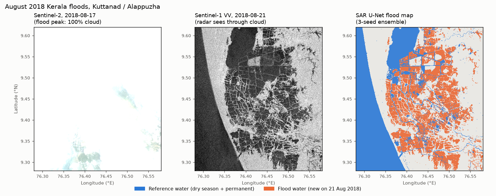

# Milestone 5: Case Study - August 2018 Kerala Floods

**Area:** Kuttanad / Alappuzha, (76.28, 9.28, 76.58, 9.62) (lon/lat), 3340×3785 px at ~10 m (EPSG:4326, Sen1Floods11 grid).  
**Model:** SAR-only U-Net, 3-seed ensemble trained on the official Sen1Floods11 split.  
**Data:** Sentinel-1 RTC from Microsoft Planetary Computer: flood scene 2018-08-21 (orbit 165, descending); dry-season reference = per-pixel median of 2018-02-22, 2018-03-06, 2018-03-18, plus ESA WorldCover 2021 permanent water (class 80: sea, Vembanad Lake).

## Why SAR here

| Sentinel-2 scene | Tile cloud cover |
| :--- | :---: |
| 2018-08-17 (S2A) | 100.0% |
| 2018-08-15 (S2B) | 100.0% |

Optical imagery during the flood peak week was almost entirely clouded; Sentinel-1 imaged the area regardless.

## Flood extent

| Quantity | Value |
| :--- | :---: |
| Valid analysis area | 1239 km² |
| Water on 2018-08-21 | 641 km² |
| Reference water (dry-season SAR ∪ WorldCover permanent water) | 356 km² |
| **Flooded (new water)** | **314 km²** (25.4% of area) |

Without the WorldCover permanent-water mask the flooded area would be 400 km²: wind-roughened sea in the dry-season scenes is radar-bright, is missed as reference water, and would otherwise be counted as flood.

## Independent optical cross-check

Sentinel-2 L2A `S2B_MSIL2A_20180822T050649_R019_T43PFL_20201011T052858` (one day after the SAR pass, 31% tile cloud cover); 72% of the area is cloud-free per the Scene Classification Layer. On those pixels only:

| Optical reference | IoU with SAR water | SAR water confirmed by optical | Optical water found by SAR | Pixel agreement |
| :--- | :---: | :---: | :---: | :---: |
| MNDWI > 0.15 | 79.9% | 84.1% | 94.1% | 89.5% |
| SCL water class | 78.6% | 82.5% | 94.3% | 88.9% |

## Caveats

- **Sensor processing shift:** Planetary Computer supplies radiometrically terrain-corrected gamma0 (RTC); Sen1Floods11 uses GEE sigma0 GRD. Scene mean VV/VH here: -12.7 / -18.0 dB vs train -10.4 / -17.2 dB. No recalibration is applied.
- **Timing:** the S1 pass (21 Aug) is ~4 days after the peak (~16–17 Aug), so the mapped extent understates peak inundation.
- **Reference water** includes the sea, Vembanad Lake, backwaters and paddy fields that were flooded in the dry season; 'flood water' is the increase over that baseline, not total water.
- **No ground truth:** the optical cross-check is agreement with an independent sensor on clear pixels, not accuracy. Optical water indices also miss water under vegetation and in cloud shadow.

Interactive map: `outputs/kerala/kerala_flood_map.html` (open in a browser). GeoTIFFs: `outputs/kerala/kerala_flood_classes.tif` (0 land, 1 reference water, 2 flood, 255 no-data), `kerala_flood_prob.tif`, `kerala_reference_prob.tif`.
