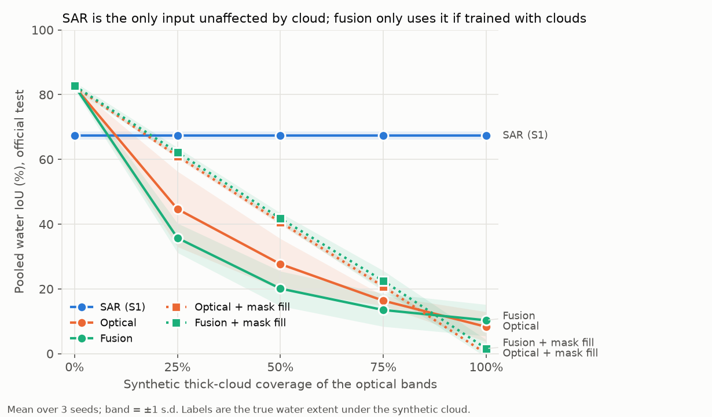
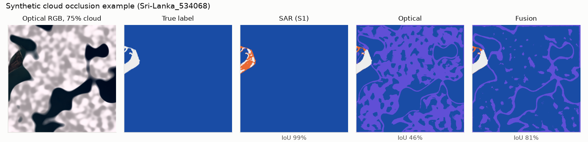
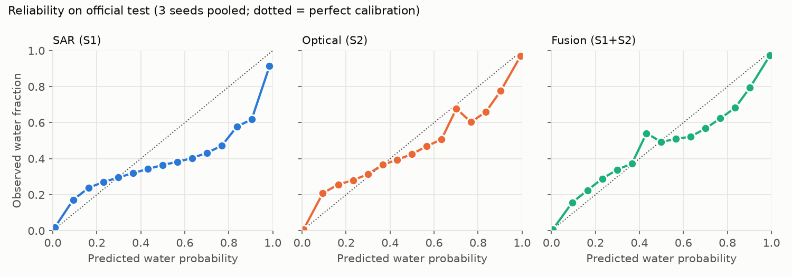
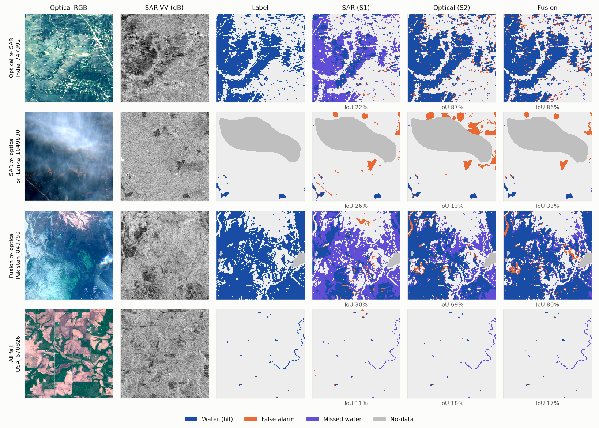

# Milestone 4: Failure Analysis & Cloud Robustness

## A. Synthetic cloud occlusion (official test, 90 chips)

S2 bands are covered by synthetic thick cloud (median train-set cloud spectrum, soft edges, ±20% texture); labels keep the true water extent. *Mask fill* = cloud pixels (opacity ≥ 0.5) replaced by the train mean, i.e. a perfect cloud mask at inference. *Cloud-aug* = trained with the same synthetic clouds (p = 0.5, coverage ~ U(0, 1)) using different random fields.

Pooled water IoU (%), mean ± s.d. over seeds:

| Model | 0% | 25% | 50% | 75% | 100% |
| :--- | :---: | :---: | :---: | :---: | :---: |
| SAR (S1) | 67.3 ± 1.2 | 67.3 ± 1.2 | 67.3 ± 1.2 | 67.3 ± 1.2 | 67.3 ± 1.2 |
| Optical (S2) | 82.5 ± 0.3 | 44.7 ± 11.6 | 27.7 ± 7.8 | 16.4 ± 1.6 | 8.3 ± 4.6 |
| Fusion | 82.7 ± 1.2 | 35.7 ± 4.5 | 20.1 ± 5.4 | 13.5 ± 5.1 | 10.3 ± 4.9 |
| Optical + cloud-mask fill | 82.5 ± 0.3 | 61.0 ± 0.7 | 40.6 ± 0.8 | 20.7 ± 0.8 | 0.0 ± 0.0 |
| Fusion + cloud-mask fill | 82.7 ± 1.2 | 62.2 ± 1.5 | 41.8 ± 1.7 | 22.5 ± 3.1 | 1.6 ± 2.7 |

Paired differences (seed-summed per-chip counts, 5,000 chip bootstrap resamples), in pp:

| Comparison | 0% | 25% | 50% | 75% | 100% |
| :--- | :---: | :---: | :---: | :---: | :---: |
| Fusion − Optical (S2) | +0.2 [-1.3, +1.7] | -6.1 [-6.7, -5.2] | -5.0 [-5.7, -3.9] | -2.5 [-3.1, -1.9] | -0.6 [-1.0, +0.1] |
| Fusion − SAR (S1) | +15.4 [+10.2, +22.2] | -31.6 [-39.9, -22.8] | -47.5 [-55.5, -38.0] | -54.2 [-62.2, -44.4] | -57.4 [-65.5, -47.2] |
| Optical (S2) − SAR (S1) | +15.2 [+9.8, +22.2] | -25.5 [-33.7, -17.3] | -42.5 [-50.3, -33.5] | -51.6 [-59.6, -42.2] | -56.8 [-64.9, -47.1] |
| Fusion + cloud-mask fill − Optical + cloud-mask fill | +0.2 [-1.3, +1.7] | +1.2 [+0.2, +2.3] | +1.2 [+0.2, +2.2] | +1.8 [+0.6, +3.1] | +1.6 [+0.6, +2.9] |

## B. Real chips stratified by cloud

*Cloud proxy* = fraction of pixels with B2, B3, B4 > 0.18 or cirrus B10 > 0.012 (heuristic; it agrees only moderately with the labellers' no-data mask). *Labelled no-data* = fraction of pixels labelled −1 (mostly cloud and cloud shadow). Clouded pixels carry no label, so this measures performance on the *visible* part of cloudy scenes. Pooled IoU (%) of seed-summed counts.

**Official test — cloud proxy**

| Bin | Chips | SAR (S1) | Optical (S2) | Fusion |
| :--- | :---: | :---: | :---: | :---: |
| <5% | 50 | 63.7 | 82.8 | 82.2 |
| 5–30% | 22 | 78.8 | 87.6 | 87.8 |
| ≥30% | 18 | 63.0 | 68.2 | 73.2 |

**Official test — labelled nodata**

| Bin | Chips | SAR (S1) | Optical (S2) | Fusion |
| :--- | :---: | :---: | :---: | :---: |
| <5% | 55 | 65.4 | 83.6 | 83.8 |
| 5–30% | 21 | 67.0 | 81.9 | 83.7 |
| ≥30% | 14 | 75.2 | 78.7 | 77.5 |

**LOEO held-out — cloud proxy**

| Bin | Chips | SAR (S1) | Optical (S2) | Fusion |
| :--- | :---: | :---: | :---: | :---: |
| <5% | 37 | 45.3 | 72.1 | 69.7 |
| 5–30% | 35 | 55.3 | 72.4 | 70.9 |
| ≥30% | 11 | 70.5 | 81.5 | 80.5 |

**LOEO held-out — labelled nodata**

| Bin | Chips | SAR (S1) | Optical (S2) | Fusion |
| :--- | :---: | :---: | :---: | :---: |
| <5% | 29 | 42.7 | 70.6 | 68.0 |
| 5–30% | 31 | 55.7 | 74.3 | 73.2 |
| ≥30% | 23 | 62.5 | 77.0 | 75.1 |

## C. Per-event IoU (official test, mean ± s.d. over seeds)

| Event | SAR (S1) | Optical (S2) | Fusion |
| :--- | :---: | :---: | :---: |
| Ghana | 59.3 ± 0.4 | 55.6 ± 0.8 | 59.6 ± 2.6 |
| India | 67.2 ± 2.0 | 88.8 ± 0.5 | 88.6 ± 0.8 |
| Mekong | 84.3 ± 0.9 | 92.3 ± 0.4 | 92.1 ± 0.7 |
| Nigeria | 80.0 ± 1.0 | 93.3 ± 0.2 | 92.9 ± 0.3 |
| Pakistan | 32.9 ± 2.3 | 64.3 ± 6.6 | 61.2 ± 19.1 |
| Paraguay | 68.3 ± 4.9 | 75.5 ± 0.9 | 74.5 ± 9.5 |
| Somalia | 53.8 ± 2.9 | 79.9 ± 1.0 | 79.8 ± 0.7 |
| Spain | 69.4 ± 3.2 | 83.4 ± 0.6 | 83.3 ± 0.7 |
| Sri-Lanka | 79.5 ± 1.8 | 90.1 ± 2.7 | 93.0 ± 0.3 |
| USA | 55.4 ± 2.1 | 78.9 ± 1.4 | 77.3 ± 1.9 |

## D. Calibration

## E. Qualitative failure cases (seed 42)

Chips: India_747992, Sri-Lanka_1049830, Pakistan_849790, USA_670826. Blue = hit, orange = false alarm, violet = missed water.

## F. Inference cost (batch 1, AMP)

| Model | Params | ms / 512×512 chip | Device |
| :--- | :---: | :---: | :--- |
| SAR (S1) | 24.43M | 21.6 | NVIDIA GeForce RTX 3060 Laptop GPU |
| Optical (S2) | 24.47M | 22.4 | NVIDIA GeForce RTX 3060 Laptop GPU |
| Fusion (S1+S2) | 24.47M | 22.2 | NVIDIA GeForce RTX 3060 Laptop GPU |
